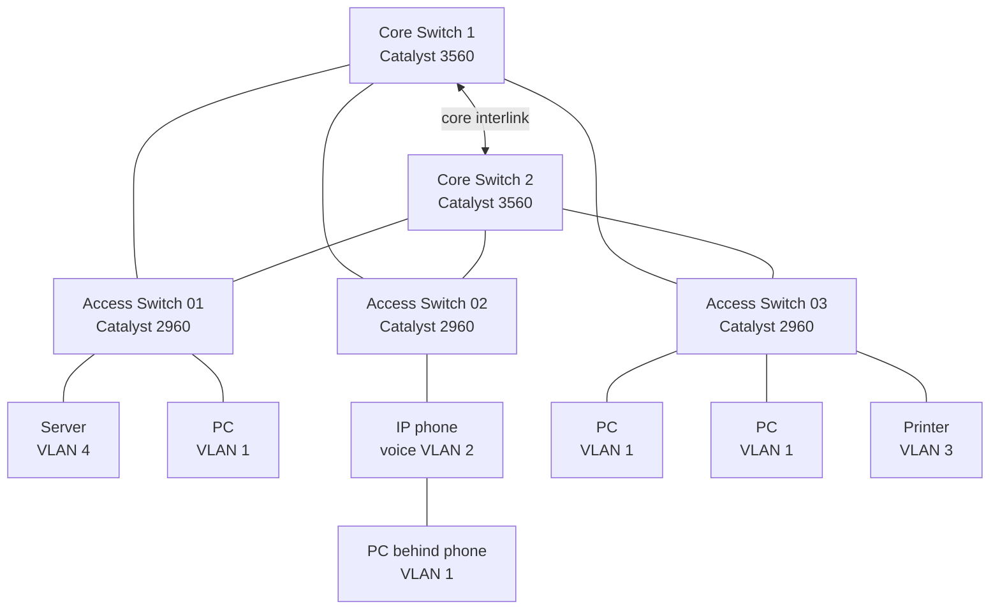
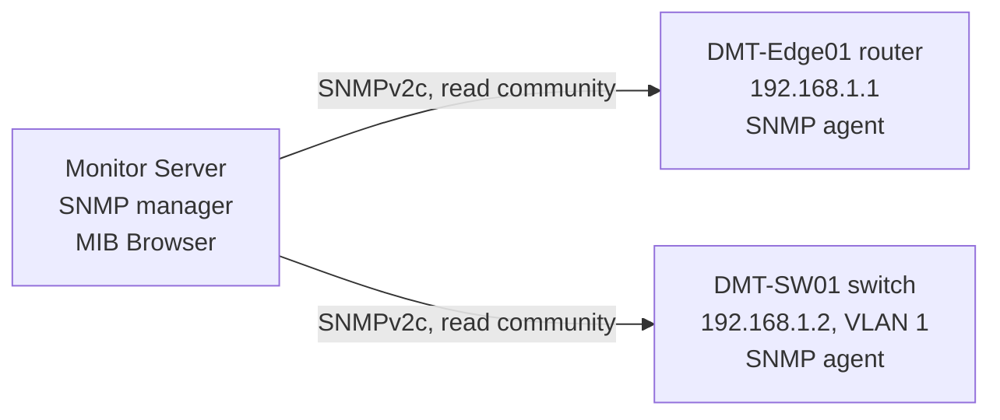

# 01 - Architecture and Design

This page describes the network built in both labs, the design choices behind it, and the places where the source documentation is incomplete.

## Contents

- Platform
- Lab 1 topology
- Collapsed core design
- Device inventory
- Documented port assignments
- Redundancy and Spanning Tree
- Lab 2 topology
- How the two labs relate
- Gaps in the source documentation

## Platform

Both labs were built in **Cisco Packet Tracer**, a free network simulator from Cisco. It runs real Cisco IOS command syntax, so the commands used here are the same ones used on physical Catalyst switches and Cisco routers. It does not implement every feature of real hardware. The documented differences are listed in Troubleshooting and Known Issues.

## Lab 1 topology

Two Layer 3 core switches and three Layer 2 access switches. Every access switch has an uplink to both core switches. The two core switches are also joined by a trunk link, which appears as a “10G Trunk” in the topology diagrams of the documentation.

The full Lab 1 topology in the Packet Tracer workspace: both core switches, three access switches, and every end device, with device labels visible.

## Collapsed core design

A traditional campus network has three layers:

| Layer | Role |
| --- | --- |
| Access | Where end devices connect: desktops, laptops, printers, IP phones, servers |
| Distribution | Aggregates access switches and applies policy such as security and routing |
| Core | High-speed backbone that moves traffic between parts of the network |

In a **collapsed core** (two-tier) design the distribution and core layers are combined in one set of switches. That reduces cost and complexity and suits small and medium-sized networks. Larger campuses with many buildings usually keep the three layers separate so the network is easier to scale and manage.

Here the two Catalyst 3560 switches fill both roles. The 3560 is a Layer 3 switch, so it can route between VLANs when configured to. The Catalyst 2960 access switches are Layer 2 only and cannot do inter-VLAN routing, which is why that function belongs on the core.

> [!NOTE]
Inter-VLAN routing was not configured in this lab. See Known Issues.
> 

## Device inventory

| Device | Model | Layer | Role |
| --- | --- | --- | --- |
| Core Switch 1 | Catalyst 3560 | 3 | Collapsed core (distribution and core) |
| Core Switch 2 | Catalyst 3560 | 3 | Collapsed core, redundant partner of Core Switch 1 |
| Access Switch 01 | Catalyst 2960 | 2 | Connects a server and a PC |
| Access Switch 02 | Catalyst 2960 | 2 | Connects an IP phone with a PC behind it |
| Access Switch 03 | Catalyst 2960 | 2 | Connects two PCs and a printer |

The topology diagrams in the documentation label the switches 3560-24PS and 2960-24TT.

## Documented port assignments

| Switch | Port | Connected device | Mode | VLAN |
| --- | --- | --- | --- | --- |
| Access Switch 01 | Fa0/1, Fa0/2 | Uplinks to Core Switch 1 and 2 | Trunk | 1,2,3,4 allowed, native 1 |
| Access Switch 01 | Fa0/3 | Server | Access | 4 (SERVERS) |
| Access Switch 01 | Fa0/4 | PC | Access | 1 (default) |
| Access Switch 02 | Fa0/1 | IP phone, PC behind phone | Access + voice | Data 1, voice 2 |
| Access Switch 03 | Fa0/1, Fa0/2 | PCs | Access | 1 (default) |
| Access Switch 03 | Fa0/3 | Printer | Access | 3 (PRINTERS) |
| Core Switch 1 and 2 | Fa0/1 - Fa0/3 | Downlinks to Access Switch 01 - 03 | Trunk | 1,2,3,4 allowed, native 1 |

The uplink ports of Access Switch 02 and 03 are not recorded. See Gaps in the source documentation.

## Redundancy and Spanning Tree

Each access switch has two uplinks, one to each core switch. If a cable or a core switch fails, traffic can use the remaining path.

Redundant paths create the possibility of a Layer 2 loop. A loop makes frames circulate repeatedly, which can turn into a broadcast storm that slows or stops the network. Cisco switches run **Spanning Tree Protocol (STP)** by default. STP blocks one of the redundant links and keeps it as a standby. If the active link fails, STP can unblock the standby so communication continues without manual changes.

STP was left at its defaults. No STP commands were run, so root bridge placement and failover behaviour were not examined.

## Lab 2 topology

A separate, smaller topology built for SNMP monitoring.

| Device | Address | Role |
| --- | --- | --- |
| Router DMT-Edge01 | 192.168.1.1 | Network gateway, configured as SNMP agent |
| Switch DMT-SW01 | 192.168.1.2 (VLAN 1) | Configured as SNMP agent |
| Monitor Server | Valid IP address, value not recorded | SNMP manager, runs the MIB Browser |
| Application servers | Not recorded | Present to make the network more realistic, not part of the SNMP configuration |
| PCs | Not recorded | End-user devices connected to the switch, not part of the SNMP configuration |

The Monitor Server also had a **NetFlow Collector** tool. It was looked at but not used.

> **Screenshot Placeholder**
> 
> 
> Insert screenshot here:
> 
> `screenshots/lab2-topology-packet-tracer.png`
> 
> - **Capture:** The Lab 2 topology in the Packet Tracer workspace: router DMT-Edge01, switch DMT-SW01, the Monitor Server, application servers and PCs.
> - **Why:** Shows the SNMP manager and agents and how they are connected.
> - **Where:** Packet Tracer, logical workspace view.

## How the two labs relate

Lab 1 builds a segmented, resilient switching network. Lab 2 shows how devices like these are monitored from one place over SNMP. The documentation presents them as two parts of one idea: a network should be built correctly and then monitored. VLAN grouping also helps with monitoring, because a problem reported for a VLAN points to a device type (VLAN 4 servers, VLAN 2 phones, VLAN 1 PCs).

Lab 2 was run on its own small topology. The documentation does not say that the Lab 2 switch is one of the Lab 1 switches.

## Gaps in the source documentation

These are recorded here and not filled in with assumptions.

| Item | What the documentation shows |
| --- | --- |
| Uplink ports on Access Switch 02 and 03 | Trunk configuration is shown for Access Switch 01 (Fa0/1 - Fa0/2). The summary says all access uplinks were configured as trunks, but the port numbers for the other two switches are not recorded. Access Switch 03 uses Fa0/1 - Fa0/3 for end devices, so its uplinks are on other ports. |
| Core interlink | Drawn as a 10G trunk in the topology diagrams. Its configuration is not in the written steps. |
| Number of PCs | The port configuration describes one PC on Access Switch 01, one behind the phone on Access Switch 02 and two on Access Switch 03. The IP address table lists five PCs. |
| Lab 2 monitor server and PC addresses | Not recorded. |

Next: VLAN Design and IP Addressing
