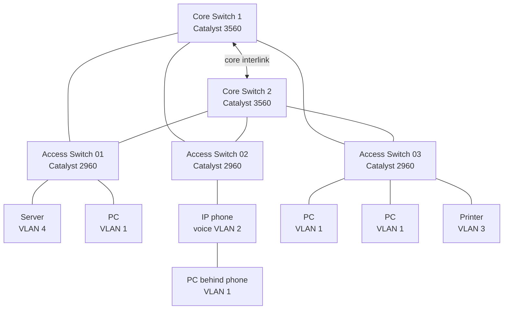
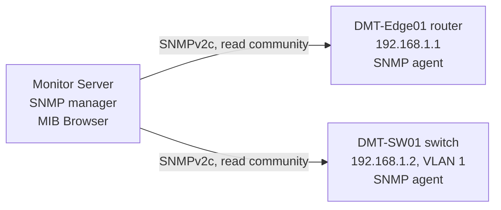

# VLAN Design, Trunking and SNMPv2 Monitoring Lab

Two Cisco Packet Tracer labs. The first builds a collapsed-core switched network with VLANs, access ports, a voice VLAN and 802.1Q trunks. The second configures SNMP version 2 on a router and a switch and queries them from a monitoring server.

Author: Clinton Kehinde | Platform: Cisco Packet Tracer | Status: Completed and verified in the simulator

## Contents

- Overview
- Objectives
- Technologies Used
- Skills Demonstrated
- Environment
- Lab 1 Architecture
- Design Summary
- Lab 2 Architecture
- Project Scope
- Repository Structure
- Reproducing the Labs
- Validation
- Troubleshooting
- Security Considerations
- Lessons Learned
- Future Improvements
- Documentation
- License
- Author

## Overview

A network needs to be built correctly and then monitored. These labs cover both halves with real Cisco IOS commands in Packet Tracer.

**Lab 1** separates PCs, IP phones, printers and a server into VLANs across five switches, then joins the switches with trunk links so a device on one access switch can reach a device on another. **Lab 2** sets up SNMP version 2 with read-only access so a central server can read status, interface and routing information from a router and a switch without logging into either.

Each step in the documentation explains what the commands do, why they are needed, and what goes wrong if they are missing or wrong.

## Objectives

- Design a VLAN plan that groups devices by type
- Configure access ports, a voice VLAN and 802.1Q trunks on Catalyst 2960 and 3560 switches
- Understand the collapsed-core design and the role of redundant uplinks
- Verify each stage with `show` commands and an end-to-end ping
- Configure SNMPv2c agents with least-privilege access and query them with a MIB Browser
- Record problems, causes and limitations accurately

## Technologies Used

| Technology | Use |
| --- | --- |
| Cisco Packet Tracer | Network simulation |
| Cisco IOS CLI | Switch and router configuration |
| Catalyst 3560 (Layer 3) | Collapsed core switches |
| Catalyst 2960 (Layer 2) | Access switches |
| VLANs and voice VLAN | Segmentation by device type, voice and data on one port |
| IEEE 802.1Q | Trunk encapsulation |
| Spanning Tree Protocol | Loop prevention on redundant links (defaults, not configured) |
| SNMPv2c | Remote monitoring |
| MIB Browser | SNMP queries from the Monitor Server |
| Static IPv4 addressing | Device addressing (no DHCP in the lab) |

## Skills Demonstrated

- Designing a VLAN plan and applying it consistently across switches
- Configuring access ports, voice VLANs and `interface range` for multi-port settings
- Configuring trunk ports: mode, native VLAN and allowed VLAN list
- Knowing the difference between the 2960 and 3560 trunk configuration, and the `switchport trunk allowed vlan add` safeguard
- Explaining a collapsed-core network design and why redundancy and STP matter
- Static IP planning using the VLAN number as the third octet
- Verifying with `show vlan`, `show interfaces ... switchport`, `show running-config` and `ping`
- Configuring SNMPv2c agents with a read-only community and reading data through a MIB Browser
- Explaining SNMP concepts: agent, manager, MIB, OID and community string
- Describing the security limits of SNMPv2c and how SNMPv3 differs
- Technical documentation, including known issues and untested areas

## Environment

| Item | Detail |
| --- | --- |
| Simulator | Cisco Packet Tracer |
| Environment | Simulated enterprise network |
| Lab 1 devices | 2 x Catalyst 3560 (core), 3 x Catalyst 2960 (access), PCs, IP phone, printer, server |
| Lab 2 devices | Router DMT-Edge01, switch DMT-SW01, Monitor Server, application servers, PCs |
| Addressing | Static, no DHCP |

## Lab 1 Architecture



Every access switch has an uplink to both core switches, so a cable or core switch failure leaves another path. The 3560 core switches combine the distribution and core layers. Details are in Architecture and Design.

## Design Summary

| VLAN | Name | Devices | Subnet |
| --- | --- | --- | --- |
| 1 | default | PCs and laptops (also management in this lab) | 192.168.1.0/24 |
| 2 | PHONES | IP phones (voice VLAN) | 192.168.2.0/24 |
| 3 | PRINTERS | Printers | 192.168.3.0/24 |
| 4 | SERVERS | Servers | 192.168.4.0/24 |

| Link type | Configuration |
| --- | --- |
| End-device ports | `switchport mode access` with the device VLAN |
| IP phone port | Access VLAN 1 for the PC, voice VLAN 2 for the phone |
| Access to core uplinks | Trunk, native VLAN 1, allowed VLANs 1 to 4 |
| Core downlinks (3560) | `switchport trunk encapsulation dot1q`, then the same trunk settings |

## Lab 2 Architecture



The router and switch use a read-only community. From the MIB Browser the router returned system description, uptime, interfaces, speeds, MAC addresses, administrative status and the routing table, and the switch returned interfaces, MAC addresses, speeds and port status. Details are in SNMP Monitoring.

## Project Scope

**In scope**

- VLAN design and creation on five switches
- Access ports, voice VLAN and trunk configuration
- Static IP addressing and an end-to-end connectivity test
- SNMPv2c configuration on one router and one switch and MIB Browser queries

**Out of scope**

- Inter-VLAN routing
- DHCP
- STP tuning and failover testing
- SNMPv3, traps, polling and alerting
- Physical hardware

## Repository Structure

```
.
├── README.md
├── LICENSE
├── .gitignore
├── configs/
│   ├── README.md
│   ├── lab1-vlan-trunking/
│   │   ├── all-switches-vlan-database.txt
│   │   ├── access-switch-01.txt
│   │   ├── access-switch-02.txt
│   │   ├── access-switch-03.txt
│   │   └── core-switches-trunk.txt
│   └── lab2-snmp/
│       ├── router-dmt-edge01.txt
│       ├── switch-dmt-sw01.txt
│       └── optional-location-and-contact.txt
├── docs/
│   ├── 01-architecture-and-design.md
│   ├── 02-vlan-design-and-ip-addressing.md
│   ├── 03-access-ports-and-voice-vlans.md
│   ├── 04-trunking.md
│   ├── 05-snmp-monitoring.md
│   ├── 06-testing-and-validation.md
│   ├── 07-troubleshooting-and-known-issues.md
│   ├── 08-security-considerations.md
│   ├── 09-lessons-learned.md
│   └── 10-command-reference.md
└── screenshots/
    └── README.md
```

## Reproducing the Labs

The Packet Tracer project file is not included in this repository, so the labs are rebuilt from the documentation.

1. Build the topology in Packet Tracer as described in Architecture and Design.
2. Paste `all-switches-vlan-database.txt` into all five switches.
3. Apply the access switch files, then `core-switches-trunk.txt` on both core switches. The uplink ports of Access Switch 02 and 03 are not recorded and have to be chosen to match your cabling.
4. Assign static IP addresses from VLAN Design and IP Addressing and ping between PCs on different access switches.
5. For Lab 2, apply the files in `configs/lab2-snmp/` and query each device from the Monitor Server MIB Browser using community `private` and SNMP version 2.

## Validation

Each stage was verified before the next one:

- `show vlan` on all five switches showed VLANs 1 to 4 with the correct names
- `show interfaces fastethernet 0/1 switchport` and `show running-config` confirmed the core trunk settings
- A ping from PC 1 to PC 4, on different access switches, succeeded
- `show snmp` was accepted on the router, and the MIB Browser returned data from both the router and the switch

Testing and Validation lists every check, plus what was not tested (voice VLAN operation, VLAN isolation, inter-VLAN routing, STP failover, SNMP failure cases).

## Troubleshooting

Problems met and their causes are recorded in Troubleshooting and Known Issues. Examples:

- VLAN 1 cannot be renamed because it is the reserved default VLAN
- A 3560 needs `switchport trunk encapsulation dot1q` before trunk mode
- `switchport trunk allowed vlan 5` replaces the list. Use `add`
- The Packet Tracer IP phone starts powered off
- “Bad Value” in the MIB Browser is a Packet Tracer limitation

## Security Considerations

Applied in the labs: segmentation by VLAN, explicit access mode on end-device ports, restricted trunk VLAN lists, matching native VLANs, and read-only SNMP following least privilege.

Not covered, and recorded so the design is not overstated: the SNMP community string `private` is a well-known value sent in plain text by SNMPv2c, SNMP queries are not restricted to the monitoring server, and VLAN 1 carries user, management and native traffic. See Security Considerations.

## Lessons Learned

- Plan the design before typing commands
- Every switch in a path must know every VLAN it carries
- Set modes explicitly instead of relying on defaults
- Verify each stage before building the next
- Know the limits of the simulator
- Monitoring is the second half of building a network

More in Lessons Learned.

## Future Improvements

These were not part of the labs.

- Configure inter-VLAN routing on the Layer 3 core and test isolation and access between VLANs
- Move management to a dedicated VLAN and use a native VLAN that no device uses
- Examine STP: root bridge placement, `show spanning-tree` output and a link failure test
- Test voice VLAN tagging, not only the configuration
- Add DHCP in place of static addressing
- Use SNMPv3, or at least a strong community string with an access list limiting queries to the monitoring server
- Add SNMP traps and a monitoring tool with polling and alerts
- Save the router SNMP configuration with `write memory`
- Publish the Packet Tracer project file

## Documentation

| Document | Content |
| --- | --- |
| 01 Architecture and Design | Platform, topologies, collapsed core, port map, gaps in the source |
| 02 VLAN Design and IP Addressing | VLAN plan, creation, verification, static IP scheme |
| 03 Access Ports and Voice VLANs | Access switch configuration and voice VLAN |
| 04 Trunking | Trunks, native VLAN, allowed VLAN list, 3560 encapsulation |
| 05 SNMP Monitoring | SNMPv2c agents and MIB Browser queries |
| 06 Testing and Validation | Checks performed and what was not tested |
| 07 Troubleshooting and Known Issues | Problems met, common faults, known issues |
| 08 Security Considerations | Measures applied and weaknesses not covered |
| 09 Lessons Learned | What the labs taught |
| 10 Command Reference | IOS commands used |

Configuration files are described in `configs/README.md`. Screenshots are tracked in `screenshots/README.md`, and placeholder blocks in the documents show where each capture belongs.

## License

Released under the MIT License.
